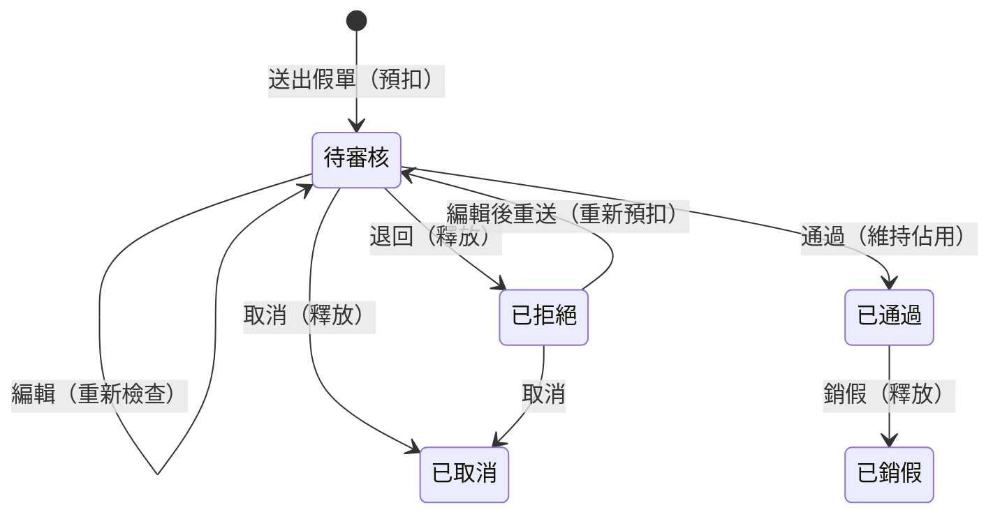

# 請假系統規格書（第一階段：核心功能）
 
Oct 29, 2026 · @yoyo（v3：已與部署中的前後端逐項比對並決議）
 
> 第二階段 AI 助理另見 `specs/ai-assistant-spec.md`
 
## 1. 系統概述與階段劃分
 
單一部門的內部請假系統：員工線上申請、主管審核，系統依受雇日期以週年制動態計算特休、病假、事假的可用時數；第二階段加入自架模型的 AI 助理。
 
| 階段 | 範圍 | 涉及 | 章節 |
| --- | --- | --- | --- |
| **第一階段：請假系統核心** | AI 對話以外的所有功能：角色、帳號、假別額度、請假流程、驗證、操作紀錄 | 前端、後端、資料庫的建立與修改 | 本文件第 2～13 節 |
| **第二階段：AI 助理（Modal）** | 以 Modal 自架模型取代 Gemini，做規章問答與假單查詢 | 新 repo `leave-system-inference`、後端 AI 模組、pgvector、前端對話介面 | `specs/ai-assistant-spec.md` |
 
- 第一階段期間，現有的 Gemini `POST /chat` 與 `/ai-analysis` 頁面**維持原樣不動**
- 第二階段開始前，第一階段必須完成上線（AI 的假單查詢工具依賴第一階段的權限與額度邏輯）
**共通設定**
 
- 使用範圍：全公司只有一個部門
- 技術棧：Next.js（App Router）+ TypeScript + shadcn/ui + TanStack Query；FastAPI + SQLAlchemy + PostgreSQL
- 部署：前端 repo `yoyo6140/leave-system-frontend`；後端部署於 Render（自訂網域 `leaves-api.yoyodev.win`）
- 認證：JWT，以 `Authorization: Bearer` 傳送（不使用 httpOnly cookie，因前後端跨網域時 iOS Safari 會擋）
- 回應格式：`{ success, data }`／`{ success: false, error: { code, message } }`；分頁為 `{ total, page, limit, data }`（`/chat` 例外）
- 請假單位：小時（正整數），不綁定行事曆
- API 值：假別 `type` 使用**英文代碼**，前端對照成中文顯示（第 4 節）；狀態 `status` 與性別 `gender` 維持**中文值**（第 3、6 節）
- 欄位命名以現有 API（OpenAPI 0.1.0）為準，新增欄位沿用相同風格（snake\_case）；第 9、10 節以「新增」「變更」標出與現況不同處
- 額度依據：《勞動基準法》第 38 條、《勞動基準法施行細則》第 24 條、《勞工請假規則》（115 年 1 月 1 日施行版）
---
 
# 第一階段：請假系統核心
 
## 2. 角色與權限
 
系統有三種角色，所有權限都由後端檢查，前端隱藏按鈕只是介面呈現。
 
| 動作 | sup\_admin（社長） | admin（主管） | employee（員工） |
| --- | --- | --- | --- |
| 申請請假 | —（不請假） | 可 | 可 |
| 審核假單（通過／退回） | 可，所有人 | 可，所有人，含自己與其他 admin | 不可 |
| 銷假（撤銷已通過假單） | 可 | 可 | 不可 |
| 查看假單 | 所有人 | 所有人 | 僅自己 |
| 管理 admin 帳號 | 可 | 不可 | 不可 |
| 管理 employee 帳號 | 可 | 可 | 不可 |
| 修改角色 | 可 | 不可 | 不可 |
| 修改受雇日期 | 可 | 不可 | 不可 |
| 修改自己的密碼 | 可 | 可 | 可 |
 
- admin 不能把人升為 admin，也不能修改 sup\_admin；`PUT /user/{id}` 由 admin 呼叫時若變更 `role` 或 `hire_date` 一律回 403
- 系統至少保留一個啟用中的 sup\_admin，不能停用最後一個
- 任何人都不能停用自己
- AI 助理相關權限見 `specs/ai-assistant-spec.md` 第 2 節
## 3. 帳號管理
 
帳號是由後端自動產生的員工編號；建立時給預設密碼，本人登入後可自行修改，忘記密碼走 email 重設。
 
| 欄位 | 規則 | 建立後可否修改 |
| --- | --- | --- |
| 帳號 `username`（員工編號） | `A0001` 起，由 PostgreSQL sequence 產生；停用後編號不回收；建立表單不再輸入帳號 | 不可 |
| 密碼 | 建立時一律為預設 `6666666`；以 bcrypt 或 argon2 雜湊儲存；新密碼 6～12 字元 | 本人可改（需輸入舊密碼） |
| 信箱 `email` | 必填，不可重複；用於忘記密碼 | 可 |
| 姓名 `name` | 必填 | 可 |
| 身分證字號 `id_number` | 必填，只檢查長度為 10；不檢查格式、不檢查重複；畫面以遮罩顯示（`A12****789`） | 可 |
| 性別 `gender` | 必填，`男`／`女`；僅作為個人資料，不影響額度計算 | 可 |
| 出生日期 `birth_date` | 必填 | 可 |
| 受雇日期 `hire_date` | 必填；額度計算的基準 | 僅 sup\_admin，且留紀錄 |
| 角色 `role` | `sup_admin`／`admin`／`employee` | 僅 sup\_admin |
| 狀態 `is_active` | 啟用／停用 | 依第 2 節權限 |
 
**密碼**
 
- 修改自己的密碼：`POST /auth/change-password`，輸入舊密碼與新密碼，舊密碼不符回錯誤
- 忘記密碼：`POST /auth/forgot-password` 寄出重設連結（30 分鐘內有效，無論信箱是否存在都回相同訊息），`POST /auth/reset-password` 以信中 token 設定新密碼
- 不強制第一次登入修改密碼
**停用帳號**
 
- 停用後無法登入：每次 API 請求都檢查 `is_active`，已發出的 JWT 立即失效
- 該員工的假單照常可以審核、銷假，歷史紀錄照常可查
## 4. 假別與額度
 
七種假別中，只有特休、病假、事假有額度，且都以受雇日期的週年制計算；其他無上限。
 
| `type`（API 代碼） | 中文名稱 | quota\_type | 額度（小時） | 依據／備註 |
| --- | --- | --- | --- | --- |
| `annual` | 特休 | `seniority` | 依年資 0–240 | 勞基法第 38 條；年資表見第 5 節 |
| `sick` | 病假 | `fixed` | 240（30 天） | 未住院病假一年 30 日；住院病假改用「其他」 |
| `personal` | 事假 | `fixed` | 112（14 天） | 一年 14 日；家庭照顧也用事假申請 |
| `marriage` | 婚假 | `unlimited` | — | 由審核人自行判斷 |
| `bereavement` | 喪假 | `unlimited` | — | 由審核人自行判斷 |
| `official` | 公假 | `unlimited` | — |  |
| `other` | 其他 | `unlimited` | — | 生理假、住院病假等皆用此假別 |
 
- 一天以 8 小時計
- API 的 `type` 一律傳英文代碼（`POST /leaves`、`PUT /leaves/{id}`、`LeaveOut`、`QuotaItem`、`PendingLeaveItem` 都一樣）
- 中文名稱只用於顯示：前端以 `LEAVE_TYPE_LABEL: Record<LeaveTypeCode, string>` 對照，樣式常數 `LEAVE_QUOTAS` 的 key 也改成代碼
- 假別存在 `leave_types` 表（`code` 為 PK、`name` 為中文名稱），程式讀 `quota_type` 判斷，不寫死代碼
- 額度不存資料庫，每次查詢時動態計算
- 有額度的假別可用時數不足時直接擋下；無上限的假別不擋
- `/leave-quota` 回傳無上限假別時 `total_hours`、`remaining_hours` 為 `null`
## 5. 額度期間計算
 
所有假別共用同一組額度期間：從受雇日的週年日開始，到下一個週年日的前一天結束（`year_start`～`year_end`）；期間結束未休完的時數歸零，不需排程。
 
**特休年資表**
 
| 年資 | 特休天數 | 時數 |
| --- | --- | --- |
| 未滿 6 個月 | 0 | 0 |
| 6 個月以上，未滿 1 年 | 3 | 24 |
| 1 年以上，未滿 2 年 | 7 | 56 |
| 2 年以上，未滿 3 年 | 10 | 80 |
| 3 年以上，未滿 5 年 | 每年 14 | 112 |
| 5 年以上，未滿 10 年 | 每年 15 | 120 |
| 10 年以上 | 每滿 1 年加 1 天，最多 30 | 最多 240 |
 
**期間切法**（以受雇日期 2024-03-15 為例）
 
| 期間 | 特休 | 病假 | 事假 |
| --- | --- | --- | --- |
| 2024-03-15 ～ 2025-03-14 | 2024-09-14 前為 0；2024-09-15 起 24h | 240h | 112h |
| 2025-03-15 ～ 2026-03-14 | 56h | 240h | 112h |
| 2026-03-15 ～ 2027-03-14 | 80h | 240h | 112h |
 
- 第 1 年只有一個期間；特休額度在期間內的「滿 6 個月」當天從 0 變成 24h，滿 6 個月前申請特休會被擋下（額度為 0）
- 判斷特休額度時用假單的 `start_date` 計算年資，例如 2024-09-10 開始的特休假單額度為 0
- 第 2 年起每個週年日重算
**月底到職（民法期間計算）**：加月或加年後如果沒有對應日，以該月月底為期末，下一期從次月 1 日開始。例如 2024-02-29 到職，下一期從 2025-03-01 開始；2024-08-31 到職，滿 6 個月為 2025-03-01。實作以 `add_period()` 包住 `relativedelta`，日被往前收時加 1 天。
 
**可用時數**
 
```latex
\text{可用時數} = \text{額度} - \sum \text{該期間內「待審核」與「已通過」假單的時數}
```
 
- 送出即預扣：「待審核」的時數也算已佔用（目前後端只扣「已通過」，需修改）
- 假單歸屬的期間以 `start_date` 判斷；因為跨期間假單會被擋下（第 7 節），每張假單只屬於一個期間
- 送出假單時用「假單開始日期」查額度，不是用今天
- 修改受雇日期後額度自動重算；已佔用時數若超過新額度，可用時數顯示為負數，不自動處理既有假單
## 6. 請假流程與狀態
 
假單有五個狀態，送出即預扣時數，退回、取消、銷假時釋放。API 的 `status` 一律使用中文值。
 

 
被退回的假單由申請人編輯同一張後重新送出，回到待審核並重新預扣；時數不足就擋下。
 
| 目前狀態 | 動作 | 執行者 | 新狀態 | 時數 |
| --- | --- | --- | --- | --- |
| — | 送出假單 | admin、employee | 待審核 | 預扣 |
| 待審核 | 編輯 | 申請人 | 待審核 | 重新檢查 |
| 待審核 | 取消（軟刪除） | 申請人 | 已取消 | 釋放 |
| 待審核 | 通過 | admin、sup\_admin | 已通過 | 維持佔用 |
| 待審核 | 退回（必填理由） | admin、sup\_admin | 已拒絕 | 釋放 |
| 已拒絕 | 編輯後重送 | 申請人 | 待審核 | 重新預扣 |
| 已拒絕 | 取消（軟刪除） | 申請人 | 已取消 | — |
| 已通過 | 銷假（必填理由） | admin、sup\_admin | 已銷假 | 釋放 |
 
- 對應 API：送出 `POST /leaves`；編輯與退回後重送 `PUT /leaves/{id}`（「已拒絕」的假單儲存後自動回到「待審核」）；取消 `DELETE /leaves/{id}`（軟刪除，只改狀態為「已取消」，不刪資料列）；通過、退回、銷假 `PATCH /leaves/{id}/status`，body `{ status, review_note }`，「已拒絕」「已銷假」時 `review_note` 必填
- 審核人由後端從 JWT 帶入，不接受前端指定（前端不再送 `reviewer`）
- admin 可以審核自己的假單，紀錄中留有審核人
- 狀態更新一律帶條件，例如 `UPDATE … WHERE id = :id AND status = '待審核'`；影響筆數為 0 就回傳「狀態已變更，請重新整理」
- 已過去的假單也可以銷假
## 7. 假單驗證規則
 
新送出、編輯、退回後重新送出共用同一個後端驗證函式，任一檢查不通過就拒絕並回傳錯誤訊息；前端的檢查只是提醒。
 
| 檢查 | 規則 | 錯誤訊息範例 |
| --- | --- | --- |
| 必填 | 日期區間、時數、假別、理由 | 請填寫請假理由 |
| 日期順序 | `end_date` 不得早於 `start_date` | 結束日期不可早於開始日期 |
| 時數格式 | 正整數 | 時數必須為正整數 |
| 時數上限 | ≤（`end_date` − `start_date` + 1）× 8 | 時數不可超過日期區間天數 × 8 |
| 不跨期間 | 有額度的假別，`end_date` 必須在 `start_date` 所屬期間內 | 此假單跨越 3/14 與 3/15 兩個年度，請以 3/14 為界拆成兩張申請 |
| 有額度 | 特休未滿 6 個月時額度為 0 | 尚無特休額度 |
| 時數足夠 | 有額度的假別，申請時數 ≤ 可用時數 | 特休可用 16 小時，不足申請的 24 小時 |
 
- 不檢查假單時段重疊
- 不綁定行事曆：時數以員工填寫為準，日期區間用於上限檢查與期間歸屬
- 防連點：送出後按鈕立即 disabled（TanStack Query `isPending`）
## 8. 操作紀錄
 
所有假單狀態變更、假單編輯與帳號異動都要留紀錄，只新增不修改。
 
| 紀錄對象 | 記錄內容 |
| --- | --- |
| 假單（`leave_status_logs`，擴充現有 `GET /leaves/{id}/status-logs`） | 操作人、時間、動作、原狀態、新狀態、理由（退回、銷假）、編輯前後的欄位值 |
| 帳號（`user_logs`，新增 `GET /user/{id}/logs`） | 操作人、時間、被操作帳號、動作（建立、修改、停用、啟用、修改密碼、重設密碼、修改受雇日期、修改角色）、修改前後的欄位值 |
 
- 密碼與身分證字號不寫入紀錄內容，只記「已修改」
- 退回理由留在紀錄中，員工編輯重送後仍查得到歷次退回原因
## 9. 資料表設計
 
業務資料五張表；額度不存表，由受雇日期與假單即時計算。欄位名稱沿用現有 API，「狀態」欄標示與現況的差異。資料庫實際欄位以後端程式為準，改名時要同步 migration。
 
**users**
 
| 欄位 | 型別 | 說明 | 狀態 |
| --- | --- | --- | --- |
| `id` | SERIAL PK |  | 現有 |
| `username` | VARCHAR(10) UNIQUE | 員工編號，由 `employee_no_seq` 產生 `A0001` 起 | 變更：改為自動產生 |
| `password_hash` | VARCHAR | 預設 `6666666` 的雜湊 | 現有 |
| `name` | VARCHAR(100) |  | 現有 |
| `email` | VARCHAR UNIQUE | 忘記密碼用 | 現有 |
| `id_number` | VARCHAR(10) | 只檢查長度 10，不設 UNIQUE | 變更：取消格式與重複檢查 |
| `gender` | VARCHAR(2) | `男`／`女` | 變更：統一中文值 |
| `birth_date` | DATE |  | 現有 |
| `hire_date` | DATE |  | 現有 |
| `role` | VARCHAR(20) | `sup_admin`／`admin`／`employee` | 變更：新增 `sup_admin` |
| `is_active` | BOOLEAN | 預設 true | 現有 |
| `created_at`、`updated_at` | TIMESTAMPTZ |  | 現有 |
 
**leave\_types**（新增）
 
| 欄位 | 型別 | 說明 |
| --- | --- | --- |
| `code` | VARCHAR(20) PK | `annual`、`sick`…（即 API 的 `type`） |
| `name` | VARCHAR(20) | 特休、病假… |
| `quota_type` | VARCHAR(20) | `seniority`／`fixed`／`unlimited` |
| `quota_hours` | INT NULL | 僅 `fixed` 填：病假 240、事假 112 |
| `sort_order` | INT | 下拉選單排序 |
 
**leaves**（假單）
 
| 欄位 | 型別 | 說明 | 狀態 |
| --- | --- | --- | --- |
| `id` | UUID PK |  | 現有 |
| `user_id` | INT FK → users | 申請人 | 現有 |
| `type` | VARCHAR(20) FK → leave\_types.code | 英文代碼 | 變更：中文 → 英文代碼，既有資料要轉換 |
| `start_date`、`end_date` | DATE |  | 現有 |
| `hours` | INT CHECK (hours > 0) |  | 現有 |
| `reason` | TEXT NOT NULL |  | 變更：改必填 |
| `status` | VARCHAR(10) | `待審核`／`已通過`／`已拒絕`／`已取消`／`已銷假` | 變更：新增「已銷假」 |
| `reviewer_id` | INT FK → users NULL | 最後審核人；API 以 `reviewer`（姓名）輸出 | 現有（API 欄位名維持 `reviewer`） |
| `reviewed_at` | TIMESTAMPTZ NULL | 最後審核時間 | 新增 |
| `review_note` | TEXT NULL | 退回或銷假理由 | 新增 |
| `created_at`、`updated_at` | TIMESTAMPTZ |  | 現有 |
 
- 取消為軟刪除：只把 `status` 改成「已取消」，不另設 `is_deleted`
- 索引：`(user_id, type, status, start_date)`，供可用時數加總查詢使用
**leave\_status\_logs**（擴充現有）
 
| 欄位 | 型別 | 說明 | 狀態 |
| --- | --- | --- | --- |
| `id` | UUID PK |  | 現有 |
| `leave_id` | UUID FK → leaves |  | 現有 |
| `from_status`、`to_status` | VARCHAR(10) | 建立時 `from_status` 為 null；純編輯時兩者相同 | 現有 |
| `changed_by` | INT FK → users | 操作人 | 現有 |
| `changed_at` | TIMESTAMPTZ |  | 現有 |
| `action` | VARCHAR(20) | `create`／`update`／`resubmit`／`approve`／`reject`／`cancel`／`revoke` | 新增 |
| `note` | TEXT NULL | 退回、銷假理由 | 新增 |
| `changes` | JSONB NULL | 編輯前後的欄位值 `{ field: [old, new] }` | 新增 |
 
**user\_logs**（新增）
 
| 欄位 | 型別 | 說明 |
| --- | --- | --- |
| `id` | UUID PK |  |
| `user_id` | INT FK → users | 被操作的帳號 |
| `action` | VARCHAR(20) | `create`／`update`／`deactivate`／`activate`／`change_password`／`reset_password`／`update_hire_date`／`update_role` |
| `changes` | JSONB NULL | 修改前後的欄位值；密碼、身分證字號只記 `"已修改"` |
| `changed_by` | INT FK → users NULL | 操作人；忘記密碼重設時為本人 |
| `changed_at` | TIMESTAMPTZ |  |
 
## 10. API 清單
 
第一階段的 API。未標註的維持現況；`/chat` 第一階段不動。
 
| 方法 | 路徑 | 說明 | 狀態 |
| --- | --- | --- | --- |
| POST | `/auth/login` | 登入，回 `{ token }` | 現有 |
| POST | `/auth/logout` | 登出 | 現有 |
| GET | `/auth/me` | 目前使用者 | 現有 |
| POST | `/auth/forgot-password` | 寄重設信 | 現有 |
| POST | `/auth/reset-password` | 以 token 設新密碼 | 現有 |
| POST | `/auth/change-password` | 本人以舊密碼改新密碼 | 新增 |
| GET | `/users` | 員工列表（`search`、`page`、`limit`、`include_inactive`） | 現有；權限依第 2 節 |
| POST | `/user` | 新增帳號 | 變更：不再傳 `username`、`password` |
| GET | `/user/{id}` | 查詢帳號 | 現有 |
| PUT | `/user/{id}` | 修改帳號 | 變更：不再傳 `username`；`role`、`hire_date` 僅 sup\_admin |
| PATCH | `/user/{id}/status` | 啟用／停用 | 現有；加最後一個 sup\_admin 檢查 |
| GET | `/user/{id}/logs` | 帳號異動紀錄 | 新增 |
| GET | `/leaves` | 假單列表（`status`、`search`、`page`、`limit`、`mine`） | 現有 |
| POST | `/leaves` | 送出假單 | 變更：`type` 用代碼、`reason` 必填、套第 7 節驗證 |
| GET | `/leaves/{id}` | 單筆假單 | 現有 |
| PUT | `/leaves/{id}` | 編輯；「已拒絕」時儲存即重送 | 變更：允許「已拒絕」 |
| DELETE | `/leaves/{id}` | 取消（軟刪除） | 變更：允許「已拒絕」 |
| PATCH | `/leaves/{id}/status` | 通過／退回／銷假 | 變更：新增 `review_note`、允許「已通過 → 已銷假」 |
| GET | `/leaves/{id}/status-logs` | 假單紀錄 | 變更：多回 `action`、`note`、`changes` |
| GET | `/leave-quota/me` | 自己的額度（`as_of`） | 變更：預扣、`type` 用代碼 |
| GET | `/leave-quota/{user_id}` | 指定員工額度 | 同上 |
| GET | `/overview` | 管理者總覽 | 變更：`type` 用代碼；sup\_admin 可用 |
 
**Schema 變更**
 
| Schema | 欄位 | 狀態 |
| --- | --- | --- |
| `LeaveCreate`、`LeaveUpdate` | `type`（代碼）、`start_date`、`end_date`、`hours`、`reason`（必填） | 變更 |
| `LeaveStatusUpdate` | `status`、`review_note`（「已拒絕」「已銷假」時必填） | 新增 `review_note` |
| `LeaveOut` | 現有欄位 + `reviewed_at`、`review_note` | 新增 |
| `LeaveStatusLogOut` | `id`、`from_status`、`to_status`、`changed_by`、`changed_at` + `action`、`note`、`changes` | 新增 |
| `UserCreate` | `name`、`role`（預設 `employee`）、`email`、`gender`、`id_number`、`hire_date`、`birth_date` | 移除 `username`、`password` |
| `UserUpdate` | `name`、`role`、`email`、`gender`、`id_number`、`hire_date`、`birth_date` | 移除 `username` |
| `ChangePasswordRequest` | `old_password`、`new_password`（6～12 字元） | 新增 |
| `UserLogOut` | `id`、`action`、`changes`、`changed_by`、`changed_at` | 新增 |
| `QuotaItem` | `type`（代碼）、`total_days`、`total_hours`、`used_hours`、`remaining_hours`、`note`；`used_hours` 含待審核 | 變更 |
| `PendingLeaveItem` | `type`（代碼） | 變更 |
 
## 11. 必要測試案例
 
額度計算與狀態轉換是最容易寫錯的地方，以下案例上線前都要有單元測試。
 
| 分類 | 案例 | 預期結果 |
| --- | --- | --- |
| 特休 | 2024-03-15 到職，查 2024-09-14 | 特休 0h，期間 2024-03-15～2025-03-14 |
| 特休 | 2024-03-15 到職，查 2024-09-15 | 24h，期間 2024-03-15～2025-03-14 |
| 特休 | 2024-03-15 到職，查 2025-03-15 | 56h |
| 特休 | 2016-03-15 到職，查 2026-03-15（滿 10 年） | 128h（16 天） |
| 特休 | 滿 25 年 | 240h（上限 30 天） |
| 月底到職 | 2024-02-29 到職，查 2025-02-28 與 2025-03-01 | 新期間從 2025-03-01 開始 |
| 月底到職 | 2024-08-31 到職，查 2025-02-28 與 2025-03-01 | 特休 24h 從 2025-03-01 開始 |
| 病假／事假 | 到職當天 | 病假 240h、事假 112h |
| 婚假／喪假 | 任意時數 | 不擋，`remaining_hours` 為 null |
| 假別代碼 | `type` 傳 `特休` 或不存在的代碼 | 422 |
| 驗證 | 週年日前一天開始、週年日結束的假單 | 拒絕：跨期間 |
| 驗證 | 日期 1 天、時數 9 | 拒絕：超過上限 |
| 驗證 | 理由空白 | 拒絕：請填寫請假理由 |
| 預扣 | 特休剩 16h，連送兩張 16h | 第二張被拒絕 |
| 預扣 | 待審核假單被退回 | 時數釋放 |
| 退回 | 退回時沒填 `review_note` | 422 |
| 重送 | 退回後時數已被其他假單用掉，再重新送出 | 拒絕：時數不足 |
| 銷假 | 已通過假單銷假 | 狀態「已銷假」，時數釋放，紀錄有理由 |
| 競態 | 員工取消與 admin 通過同時發生 | 只有一個成功，另一個回傳狀態已變更 |
| 權限 | admin 修改 sup\_admin、改角色或改受雇日期 | 403 |
| 權限 | 停用最後一個 sup\_admin | 拒絕 |
| 權限 | 停用帳號用舊 JWT 呼叫 API | 401 |
| 帳號 | 連續建立兩個帳號 | `A0001`、`A0002`，預設密碼皆可登入 |
| 密碼 | 修改密碼時舊密碼錯誤 | 拒絕 |
| 紀錄 | 編輯假單時數 8 → 16 | `changes` 為 `{ "hours": [8, 16] }` |
 
## 12. 與現況的差異（第一階段待辦）
 
2026-10-29 比對已部署版本（前端 PR #37、後端 OpenAPI 0.1.0）後的決議。
 
| # | 項目 | 現況 | 決議 | 需修改 |
| --- | --- | --- | --- | --- |
| 1 | 預扣 | 只扣已通過 | 待審核也預扣 | 後端 |
| 2 | 假別代碼 | API 傳中文 | 改英文代碼，前端對照中文；既有資料 migration | 前後端 + 資料庫 |
| 3 | 角色 | admin／employee；admin 可透過 API 改角色 | 新增 sup\_admin，依第 2 節權限 | 前後端 + 資料庫 |
| 4 | 退回流程 | 拒絕不填理由，另送新單 | 退回必填理由，編輯同一張重送 | 前後端 + 資料庫 |
| 5 | 銷假 | 無 | 新增「已銷假」狀態 | 前後端 |
| 6 | 帳號產生 | 手動輸入帳號與密碼 | 自動編號 `A0001`、預設密碼 `6666666` | 前後端 + 資料庫 |
| 7 | 修改密碼 | 只有 email 重設 | 新增 `/auth/change-password`；保留 email 重設 | 前後端 |
| 8 | 身分證 | 前端檢查格式、後端擋重複 | 只檢查長度 10 | 前後端 |
| 9 | 婚假、喪假 | 各 8 天上限 | 無上限 | 後端 |
| 10 | 特休第一期 | 共用期間（維持） | 滿 6 個月前額度 0，之後 24h | 確認後端算法 |
| 11 | 驗證規則 | 理由選填；時數上限、跨期間未確認 | 全部照第 7 節 | 前後端 |
| 12 | 操作紀錄 | 只有狀態變更 | 擴充 `leave_status_logs`；新增 `user_logs` | 後端 + 資料庫 |
| 13 | 審核人 | 前端多送 `reviewer`（後端已忽略） | 前端拿掉 | 前端 |
| 14 | 性別值 | 前端 `男`／`女`，後端範例 `male` | 統一 `男`／`女` | 後端範例與驗證 |
 
維持現況的項目：狀態與性別使用中文值、保留 email 與出生日期（必填）、假單 id 為 UUID、所有假別共用一組額度期間。
 
**建議實作順序**：資料庫 migration（`leave_types`、`type` 轉代碼、新欄位、`user_logs`、`employee_no_seq`）→ 後端額度與驗證（預扣、第 7 節）→ 狀態流程（退回重送、銷假）→ 角色與帳號 → 操作紀錄 → 前端對應修改。
 
## 13. 不在第一階段範圍
 
- AI 助理的任何修改（見 `specs/ai-assistant-spec.md`）
- 第一次登入強制修改密碼
- 身分證字號格式、檢查碼與重複檢查
- 假單時段重疊檢查
- 行事曆（國定假日、補班日）與時數自動計算
- 證明文件上傳
- 審核結果通知（Email、LINE）
- 報表匯出、薪資扣薪計算
- 特休未休折算工資或遞延（目前期間結束歸零，後續補充）
- 住院病假「二年內合計一年」的額度計算（暫用「其他」）
- 婚假、喪假依法的天數上限與喪假親等區分（目前無上限，由審核人判斷）